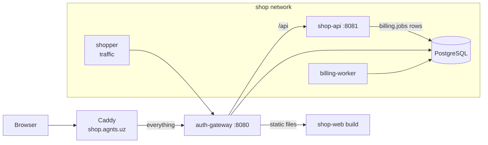

# shop-api — Implementation Plan

Nov 3, 2026 · draft · @Rustam

## Overview

shop-api is the core of **Shop**, a small online store built to demonstrate agnts on real code. It is a Go HTTP API for the catalog, carts, coupons and orders, with an OpenAPI spec, a test suite and CI. It also holds the two things the whole demo needs: `cmd/shopper`, the traffic generator, and `deploy/`, the stack that runs all four services on the agnts server.

The code is small and clean, with a handful of **planted bugs**. Each bug is real (it fails the way production code fails) and each one is the trigger for one agnts feature: the log watcher, the CI watcher, the Swagger tester and multi-repo tickets.

**The Shop system**

| Repo | What it is | Stack |
|---|---|---|
| **shop-api** (this) | Catalog, cart, coupons, orders, checkout | Go, PostgreSQL |
| shop-web | Storefront | Vue 3, Vite, TypeScript |
| billing-worker | Charges orders, writes invoices, from a job queue | Go, PostgreSQL |
| auth-gateway | Front door: sign-in, JWTs, rate limits, access log, static files, proxy | Go (Gin) |



**In scope:** the API, its spec, tests and CI; the traffic generator; the deploy stack; the demo scenarios.
**Out of scope:** real payments (billing-worker fakes the card network), an admin UI, search beyond `ILIKE`.

**Principles**

1. Small and readable: a judge should understand a file in a minute. No frameworks beyond the standard library, pgx and goose.
2. Money is integer cents (`int64`), never floats.
3. Every planted bug is listed below, has a known fix, and is the only thing wrong in its area.
4. Logs look like production logs: JSON, one line per request, Go's own panic format.
5. The planted holes are real, so the stack is isolated from agnts's own services (see Deploy).

## Layout

```
shop-api/
  cmd/shop-api/main.go        config, DB, migrations, HTTP server on :8081
  cmd/shopper/main.go         traffic generator (see Traffic)
  internal/catalog/           products: list, search, get
  internal/cart/              cart and cart items
  internal/coupon/            coupon rules and applyCoupon
  internal/order/             orders, checkout, billing job enqueue
  internal/httpx/             router, JSON helpers, middleware (log, recover)
  internal/auth/              JWT verification against auth-gateway's JWKS
  migrations/                 goose SQL migrations (schema `shop`)
  api/openapi.yaml            OpenAPI 3.1 spec, served at /api/openapi.yaml, Swagger UI at /api/docs
  deploy/                     docker-compose.yml for the whole stack, Caddy snippet, .env.example, SQL for roles
  demo/patches/               commits that trigger a scenario (CI break)
  AGENTS.md                   conventions for coding agents (agnts tells Muse to follow it)
  Dockerfile, Makefile, .golangci.yml, .github/workflows/ci.yml
```

`AGENTS.md` says how to build, lint and test, the money rule, the error-to-status mapping, the `billing.jobs` contract, and "update `api/openapi.yaml` with every API change". agnts detects `go@1.26` and the commands from `go.mod` and the Makefile.

## Data

Schema `shop` (goose migrations, run on start):

| Table | Columns |
|---|---|
| `products` | id, sku, name, description, price_cents, image_url, stock, created_at |
| `carts` | id, user_id (UUID from the JWT `sub`), updated_at |
| `cart_items` | cart_id, product_id, quantity (validated in the handler only: see API-6) |
| `coupons` | code, kind (`percent`/`fixed`), value, min_total_cents, expires_at, only_for (nullable jsonb: SKUs) |
| `orders` | id, user_id, status (`pending`/`paid`/`failed`), currency, subtotal_cents, discount_cents, total_cents, coupon_code, created_at |
| `order_items` | order_id, product_id, name, unit_price_cents, quantity |

`billing.jobs` is owned by billing-worker (its migrations). shop-api inserts a `charge_order` row in the same transaction as the order; that table is the contract between the two repos and is documented in both `AGENTS.md` files.

Seed: 40 products with images (shipped in shop-web's build), 6 coupons: `WELCOME10`, `BLACKFRIDAY`, `FREESHIP`, `VIP25`, `EXPIRED5`, `TEAM50`.

## API

On `:8081`, all under `/api`, JSON, errors as `{"error": {"code": "...", "message": "..."}}`. Auth is a Bearer JWT from auth-gateway, verified here against `AUTH_JWKS_URL` (EdDSA, keys cached 10 minutes). Public routes need no token.

| Method | Path | Auth | Notes |
|---|---|---|---|
| GET | `/api/products` | – | `?search=&limit=&cursor=`; cursor pagination |
| GET | `/api/products/{id}` | – | 404 when missing |
| GET | `/api/cart` | yes | the caller's cart with totals |
| POST | `/api/cart/items` | yes | `{product_id, quantity}`, quantity 1–99 |
| PATCH | `/api/cart/items/{product_id}` | yes | `{quantity}`, 0 removes |
| POST | `/api/cart/coupon` | yes | `{code}`; 422 when it does not apply |
| POST | `/api/checkout` | yes | `{currency, card}`; creates the order and the billing job; 409 when stock is short |
| GET | `/api/orders` | yes | the caller's orders, newest first |
| GET | `/api/orders/{id}` | yes | 404 for someone else's order |
| GET | `/api/openapi.yaml`, `/api/docs` | – | the spec and Swagger UI |
| GET | `/healthz` | – | DB ping (not proxied; compose health check only) |

`api/openapi.yaml` describes every route, schema, status and the bearer scheme. A test loads the spec and checks that every registered route is in it and the other way round.

## Logging

`log/slog` JSON to stdout:

- one `request` line per request: method, path, route pattern, status, duration_ms, ip (from `X-Forwarded-For` set by the gateway), user id
- errors at `level: error` with `err`, `caller` and the request's inputs that the failing call used (for search: the raw, decoded `search` text). agnts's injection detector needs the input and the database error **in the same line**.
- the recover middleware prints the panic to stderr in Go's own crash format (`panic: <value>`, blank line, `goroutine N [running]:`, `debug.Stack()`), then answers 500. agnts frames this as one event, so a recovered panic looks exactly like a crash.

`LOG_LEVEL` sets the level (`info` by default).

## Planted bugs

Each bug has an ID used in the demo script. "Seen by" is the agnts feature that finds it.

| ID | Where | The bug | What shows | Seen by |
|---|---|---|---|---|
| API-1 | `coupon/coupon.go` `applyCoupon` | `only_for` is read into a nil `map[string]bool` and written to for `VIP25` | `panic: assignment to entry in nil map`, 500 on checkout | Log watcher (error) |
| API-2 | `catalog/repo.go` `Search` | `search` concatenated into SQL (`ILIKE '%` + q + `%'`); the handler logs `search failed` with the text and the pgx error | a probe like `' UNION SELECT email FROM auth.users --` breaks the query (`each UNION query must have the same number of columns (SQLSTATE 42601)`) and the line holds both | Log watcher (security: SQL injection, high) |
| API-3 | `catalog/handler.go` `Get` | `pgx.ErrNoRows` not mapped to 404 | error log `failed to load product: no rows in result set`, 500 | Log watcher and Swagger tester (spec says 404) |
| API-4 | `httpx/middleware.go` debug logging | at `debug` level, logs all request headers, `Authorization` included; the deploy runs with `LOG_LEVEL=debug` | `bearer token written to the log` | Log watcher (security: secret) |
| API-5 | `order/handler.go` `List` | missing token treated as anonymous: 200 with `[]` | spec says 401 | Swagger tester |
| API-6 | `cart/handler.go` `AddItem` | quantity validated as `>= 0` instead of `>= 1`, and the table has no CHECK | 201 for quantity 0 (spec says 400); the 0-quantity item goes on to checkout and crashes billing-worker (BW-1) | Swagger tester; Log watcher via billing-worker |
| API-7 | `coupon/coupon.go` percent rounding | `demo/patches/ci-rounding.patch` changes `(total*pct + 50) / 100` to `total*pct/100`; `TestPercentRounding` fails | red `test` job on main | CI watcher |

API-6 → BW-1 is one honest chain across two services: a missing validation in the API lets bad data reach a worker that trusts it. The fix belongs in both repos, which makes it a natural multi-repo ticket too.

API-7 is not on main: the CI scenario applies the patch and pushes it as a normal commit (`make demo-break-ci`), so the judges see a real red pipeline appear and agnts react to it.

Tests cover the planted areas except the exact cases above, which is why CI is green on main.

## Traffic: `cmd/shopper`

A small Go program that drives the stack through the gateway (`http://auth-gateway:8080`), so every log line comes from real requests:

- **Accounts:** on first start it registers a fixed pool of 50 accounts (`shopper-01@shop.test` …) through `/auth/register` and reuses them; it never creates more, so the database does not grow without end. Orders older than 7 days are deleted by `make demo-clean` (also a weekly cron on the server).
- **Shoppers** (steady, 1–3 requests a second): sign in, browse, search, add to cart, apply a valid coupon, check out, list orders.
- **Incidents**, one every `SHOPPER_INCIDENT_EVERY` (default 60s, jittered), picked at random:
  - `api-1`: a checkout with `VIP25`
  - `api-2`: a search for `' UNION SELECT email FROM auth.users --` or `' OR sleep(5) --` (both break the query and match agnts's probe patterns)
  - `api-3`: a product page for a deleted product
  - `zero-qty`: add an item with quantity 0 (API-6), then check out: billing-worker crashes (BW-1)
  - `uzs`: a checkout in `UZS` (billing-worker's BW-4)
  - `brute`: 26 sign-ins with wrong passwords from one address (auth-gateway's GW-1)
  - `scan`: a scanner run over well-known paths ending with `/.env` (auth-gateway's GW-3)
- Client addresses come from `203.0.113.0/24` in `X-Forwarded-For`; the gateway trusts it only from the shop network.
- `SHOPPER_INCIDENTS=api-1,brute,...` limits incidents to a list; empty turns them off for a quiet demo.

## Deploy (`deploy/`)

One compose project `shop` in `/opt/shop` on the agnts server (45.138.158.39), next to `/opt/agnts` and `/opt/loki`.

**Services:** `postgres` (own volume; schemas `shop`, `billing`, `auth`), `shop-api`, `billing-worker`, `auth-gateway`, `shopper`. Images are built on the server from `/opt/shop/src/<repo>`, like agnts's own deploy. shop-web's `dist/` is built to `/opt/shop/web` and mounted into auth-gateway (see its plan).

**Isolation** (the planted holes are real and the site is public):

- Networks: `shop` (internal) holds postgres, shop-api, billing-worker, shopper and auth-gateway. Only **auth-gateway** also joins `agnts_default`, so Caddy can reach it. Nothing else of agnts is reachable from the shop containers.
- Database roles: `shop_api` (read/write on schema `shop`, insert on `billing.jobs`), `billing` (schema `billing`, update on `shop.orders`), `auth` (schema `auth`). None is a superuser or owns the database, so SQL injection cannot run `COPY … TO PROGRAM` or read other schemas. `deploy/roles.sql` creates them; the `postgres` superuser password is used only for that and is not in any service's environment.
- Every secret in the stack is throwaway (auth-gateway leaks its `.env` on purpose).

**Logs:** compose **service names** are `shop-api`, `billing-worker`, `auth-gateway`, and Alloy labels each stream with `service_name` and `project="shop"`. Stop `/opt/demo-runners` first (same service names, fake logs).

**Caddy** (`/opt/agnts/Caddyfile.cloud`): `shop.agnts.uz { reverse_proxy auth-gateway:8080 }`. auth-gateway serves the web app, so Caddy has one rule and every path, `/.env` included, reaches the gateway.

## agnts setup (Meta workspace)

1. Repositories: `shop-api`, `shop-web`, `billing-worker`, `auth-gateway` from GitHub (`rustambekabdusalomov/<name>`), ticket prefix `SHOP`.
2. Group **Shop** with all four, roles `backend`, `web`, `worker`, `gateway`, and group instructions: how the services talk (gateway → api, api → `billing.jobs` → worker), the money rule, "an API change updates `api/openapi.yaml` and shop-web's `src/api/types.ts`".
3. Log watcher: a **new** Loki source in the Meta workspace at `http://loki:3100` with base selector `{project="shop"}`, so it reads only the shop stack and never agnts's own logs. Map `shop-api`, `billing-worker`, `auth-gateway` to their repos; report-only first, automatic tickets on for the demo. Leave workspace 1's `server-loki` source as it is.
4. Settings → Network → Extra allowed hosts: `shop.agnts.uz`, so the Swagger tester can reach the API from run containers.
5. CI watching on for `shop-api` and `shop-web` (GitHub webhook with Workflow runs).
6. Muse connected, credits granted, slots ≥ 2 (a ticket and its review run together).

## CI

`.github/workflows/ci.yml` on push and PR: `go vet`, `golangci-lint`, `go test -race ./...` against a Postgres service container, `docker build`. Under 2 minutes, so a CI round-trip fits in a live demo.

## Demo scenarios

| # | Scenario | Trigger | What the judges see in agnts |
|---|---|---|---|
| 1 | Crash → fix | shopper's `api-1` | Log watcher groups the panics by cause, opens a ticket on shop-api; Muse fixes `applyCoupon` and adds a test; live cost on the ticket; review; PR after approval |
| 2 | SQL injection | shopper's `api-2` | High-severity security finding with the probe and the route; ticket with a parameterized-query fix |
| 3 | Swagger test | Swagger test ticket on `https://shop.agnts.uz/api/openapi.yaml`, **write requests on**, token from `auth-gateway token --email swagger@shop.test --ttl 24h` | Pass/fail table: API-3, API-5, API-6 fail with the exact requests |
| 4 | Red CI | `make demo-break-ci` | CI watcher triages the failing test as a code bug, opens a ticket; the fix is ready to review |
| 5 | Multi-repo (live) | group ticket on **Shop** limited to shop-api + shop-web: "show the discount on the order page" | One run; shop-api adds `discount_cents` to the order schema and spec, shop-web shows it; two cross-linked PRs; a preview for the web part |
| 5b | Multi-repo (recorded) | same with billing-worker: "…and on invoices" | Three PRs; shown from a run done before the session, since three repos take longer and cost more live |
| 6 | Token in logs | always on with `LOG_LEVEL=debug` (API-4) | Secret finding with the masked token and the advice to rotate |
| 7 | Bad data across services | shopper's `zero-qty` | billing-worker's panic finding; the review traces it back to API-6 |

**Between demos:** close the fix PRs instead of merging them, so the bugs stay. If one is merged, revert it on main. `make demo-reset-ci` reverts the API-7 commit.

## Testing

- Unit tests per package; DB tests with `SHOP_TEST_DATABASE_URL` (a fresh database per run).
- `httpx` test: every route in the router is in `openapi.yaml` and the reverse.
- `shopper` has a `-dry-run` that prints the requests it would send.

## Phases

1. Schema, catalog, cart, coupons, orders, checkout, JWT verification, spec, tests, CI. Bugs API-1 to API-6 in place.
2. `cmd/shopper` and `deploy/` (networks, roles); stack up behind `shop.agnts.uz`; demo-runners stopped; Meta's log source.
3. Demo patch (API-7), Makefile targets, AGENTS.md; a dry run of every scenario in the Meta workspace; record 5b.

## Decisions

- **Postgres table as the queue** between shop-api and billing-worker (`SELECT … FOR UPDATE SKIP LOCKED`): no broker to run, and a cross-repo contract a multi-repo ticket has to respect.
- **JWT verified in shop-api**, not only at the gateway: each service stands alone, and a Swagger test on the API still exercises auth.
- **Standard library router** (Go 1.22+ patterns) over chi or Gin: fewer dependencies for the agent to reason about; the gateway uses Gin on purpose (see its plan).
- **Least-privilege roles and a private network** for a stack with real holes on the same server as production agnts.
