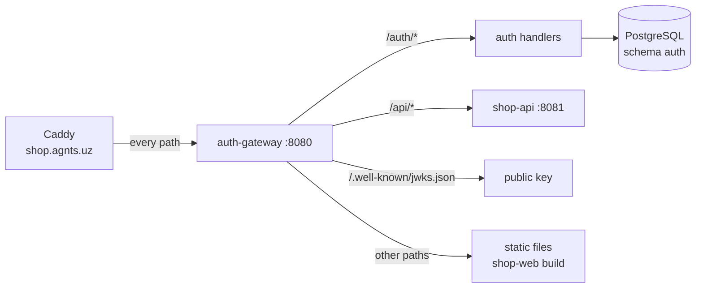

# auth-gateway — Implementation Plan

Nov 3, 2026 · draft · @Rustam

## Overview

auth-gateway is the front door of **Shop**, the demo store for agnts. It is a Go service with Gin that signs users up and in, issues JWTs, publishes the signing key, rate-limits, writes the access log, serves the web app and proxies `/api` to shop-api.

It exists to show agnts's **security** side: the attacks and mistakes that are visible only in logs. Brute-force sign-ins, scanners, an exposed `.env`, debug mode in production and personal data in the log all come from this service, and each one is a real bug in its code or configuration, not a fake log line.

**The Shop system**

| Repo | What it is | Stack |
|---|---|---|
| shop-api | Catalog, cart, coupons, orders, checkout | Go, PostgreSQL |
| shop-web | Storefront | Vue 3, Vite, TypeScript |
| billing-worker | Charges orders, writes invoices | Go, PostgreSQL |
| **auth-gateway** (this) | Sign-in, JWTs, rate limits, access log, static files, proxy | Go (Gin) |



**In scope:** register, login, refresh, logout, me; an Ed25519 JWT key with JWKS; per-IP and per-account rate limits; the reverse proxy; static files with the SPA fallback; combined access log; a token command for the demo; tests; CI.
**Out of scope:** OAuth providers, email verification, 2FA, password reset, key rotation, refresh-token reuse detection.

**Principles**

1. Passwords hashed with argon2id; access tokens live 15 minutes, refresh tokens 30 days, rotated on use and stored hashed.
2. The gateway does not authorize `/api` calls; it passes the bearer token through and shop-api verifies it. The gateway's job is identity, limits and the edge.
3. The access log is the standard combined format, one line per request, so any log tool (and agnts) can read it.
4. Gin on purpose: it is the most common Go web framework, and its debug mode is a mistake agnts recognizes.

## Layout

```
auth-gateway/
  cmd/auth-gateway/main.go     config (.env + env), DB, migrations, key, router, server; `token` subcommand
  internal/account/            users: register, verify password, lockout counters
  internal/token/              issue and verify JWTs, refresh token rotation, JWKS
  internal/limit/              token-bucket rate limits per IP and per email
  internal/edge/               access log middleware, client IP (trusted proxies), reverse proxy, static files
  internal/httpx/              JSON errors, request ids
  migrations/                  goose SQL migrations (schema `auth`)
  AGENTS.md                    conventions, the JWT contract with shop-api
  Dockerfile, Makefile, .golangci.yml, .github/workflows/ci.yml
```

## Data

Schema `auth`:

| Table | Columns |
|---|---|
| `users` | id (UUID), email (unique, lower-case), password_hash, name, created_at, failed_logins, locked_until |
| `refresh_tokens` | token_hash, user_id, expires_at, rotated_at, user_agent, ip |
| `signing_key` | one row: kid, private_key_enc, created_at |

The Ed25519 key is created on first start and encrypted with `AUTH_KEY_SECRET`.

## API

| Method | Path | Notes |
|---|---|---|
| POST | `/auth/register` | `{email, password, name}`; password ≥ 10 chars; returns the access token and sets the refresh cookie |
| POST | `/auth/login` | `{email, password}`; same response; 401 on failure, 429 when limited |
| POST | `/auth/refresh` | refresh cookie → new access token, rotated refresh cookie |
| POST | `/auth/logout` | revokes the refresh token, clears the cookie |
| GET | `/auth/me` | the user behind the bearer token |
| GET | `/.well-known/jwks.json` | the public key (shop-api reads this) |
| ANY | `/api/*` | proxied to `SHOP_API_URL` (`http://shop-api:8081`), with `X-Forwarded-For`, `X-Request-ID` |
| GET | anything else | static files from `ASSETS_DIR`, see below |
| GET | `/healthz` | DB ping |

JWT claims: `sub` (user id), `email`, `name`, `iat`, `exp`, `iss: shop.agnts.uz`, `aud: shop-api`, header `kid`. The refresh cookie is `HttpOnly; Secure; SameSite=Strict; Path=/auth`.

**Static files and the SPA fallback.** A path that names an existing file is served as is. Otherwise, a `GET` whose `Accept` includes `text/html` and whose last segment has no extension gets `index.html` (Vue Router handles it); anything else is `404`. Scanners (no `text/html`, paths like `/wp-login.php`) get `404`s, so agnts sees probes that fail, and the one that succeeds stands out.

**Token command:** `auth-gateway token --email swagger@shop.test --ttl 24h` signs in (creating the account if needed) and prints an access token with that lifetime, for agnts's Swagger test. Only the CLI can make tokens longer than 15 minutes.

**Rate limits:** `/auth/login` 10 per minute per IP and 5 failures per 15 minutes per email (then `locked_until`); `/auth/register` 5 per hour per IP; everything else 50 per second per IP.

## Logging

- **Access log** (`internal/edge`): combined format on stdout, `203.0.113.7 - - [03/Nov/2026:10:00:00 +0000] "POST /auth/login HTTP/1.1" 401 52 "-" "okhttp/4.12"`, with the client IP resolved from `X-Forwarded-For` when the peer is a trusted proxy (`TRUSTED_PROXIES`: Caddy's address on `agnts_default` and the `shop` network, where the shopper runs).
- **App log**: `slog` JSON on stdout for events: `user registered`, `login failed`, `account locked`, proxy errors.

## Planted bugs

| ID | Where | The bug | What shows | Seen by |
|---|---|---|---|---|
| GW-1 | `internal/limit` wiring in `main.go` | the per-IP login limiter is registered on `/auth/login/` (trailing slash), so `/auth/login` is never limited; the per-email lockout works, so an attacker trying many emails is not slowed | 26 `401`s on `POST /auth/login` from one address in a minute | Log watcher (brute force) |
| GW-2 | `internal/account/login.go` | `login failed for <email>: wrong password` at `warn`, the email in the message | `email address written to the log` | Log watcher (personal data) |
| GW-3 | Dockerfile and `internal/edge/static.go` | `ASSETS_DIR` defaults to `.`, the working directory `/app`, and the web build is mounted at `/app` itself, next to the `.env` mounted at `/app/.env`; the static handler serves dotfiles | the site works, and a scanner's `GET /.env` answers `200` after a run of `404`s | Log watcher (exposure, scanning: high) |
| GW-4 | `main.go` | `gin.Default()` with `GIN_MODE` unset | `[GIN-debug] [WARNING] Running in "debug" mode` at start, plus the route table | Log watcher (debug mode in production) |
| GW-5 | `internal/edge/clientip.go` | `TRUSTED_PROXIES` parsing drops CIDRs it can't parse and, when the list ends up empty, trusts every peer's `X-Forwarded-For` | any client can pick its own IP, which defeats the per-IP limits | Review of the GW-1 fix |

GW-1 and GW-5 together make the brute-force scenario honest: the log shows an attack the gateway should have stopped, the ticket fixes the route, and agnts's review should notice that per-IP limits mean little while any client can set its own IP.

GW-3 is the strongest single moment in the security demo: agnts flags "a scanner got `/.env`" as high severity, and the fix moves the web build to `/app/web`, points `ASSETS_DIR` there and refuses dotfiles.

shop-api's shopper drives these: its `brute` incident (wrong passwords from one address) and its `scan` incident (`/.git/config`, `/wp-login.php`, `/phpmyadmin/`, …, then `/.env`). GW-2 and GW-4 show on their own. Being public, the site will also get real scanners; they hit the same bug and show up the same way.

## Scenarios this repo plays in

| Scenario | What the judges see |
|---|---|
| Brute force | a security finding with the address, count and route; a hardening ticket; the fix moves the limiter to the right route and adds a test; the review raises GW-5 |
| Exposed `.env` | high-severity finding right after the scan burst; ticket and fix; the remediation says to rotate what the file held |
| Debug mode, PII | two medium findings with one-line fixes, good for showing "report only" versus "open a ticket" settings |
| Guard | while fixing GW-3, Muse is not allowed to read secrets or push; agnts's guard vetoes it through Muse's approvals and the ticket log shows the veto |

## Tests and CI

- Unit: password hashing and verification, JWT issue/verify, refresh rotation, limiter buckets, client IP resolution, the SPA fallback rules.
- HTTP tests with `httptest`: register → login → me → refresh → logout; 429 on the per-email lockout. GW-1, GW-3 and GW-5's cases are the ones missing.
- CI: `go vet`, `golangci-lint`, `go test -race ./...` with a Postgres service, `docker build`.

## Deploy

Built from `/opt/shop/src/auth-gateway`, compose service **`auth-gateway`** in shop-api's `deploy/docker-compose.yml`. The only shop container on two networks: `shop` (to reach postgres and shop-api) and `agnts_default` (so Caddy reaches it at `auth-gateway:8080`). Mounts: `/opt/shop/web` (shop-web's `dist/`) at `/app`, and `/opt/shop/auth-gateway.env` at `/app/.env` inside it; the binary lives in `/usr/local/bin`. The `.env` holds `DATABASE_URL` (role `auth`), `AUTH_KEY_SECRET` and `SHOP_API_URL`, exactly what GW-3 leaks: **use throwaway values**, and don't reuse the `auth` role's password anywhere. Postgres is not published and not on `agnts_default`, so the leaked URL is not reachable from outside.

## Phases

1. Schema, register/login/refresh/logout/me, key and JWKS, tests, CI.
2. Proxy, access log, rate limits, client IP, static files with the SPA fallback, `token` command.
3. Bugs GW-1 to GW-5, deploy behind `shop.agnts.uz`, log watcher mapping, a dry run of the brute-force and `.env` scenarios.

## Decisions

- **Ed25519 + JWKS** over a shared HS256 secret: shop-api never holds a key that can mint tokens.
- **The gateway serves the web app**, not Caddy: one Caddy rule, every path reaches the gateway's access log, and GW-3 is a believable deploy mistake rather than a contrived handler.
- **Gateway doesn't authorize `/api`**: keeps the gateway generic and each service self-contained (shop-api's Swagger test exercises auth on its own).
- **Combined access log** over Gin's default logger: the format agnts's brute-force and scanner detectors read, and the one nginx users already know.
- **Cut for the demo:** key rotation and refresh-token reuse detection. Neither is on a demo path.
